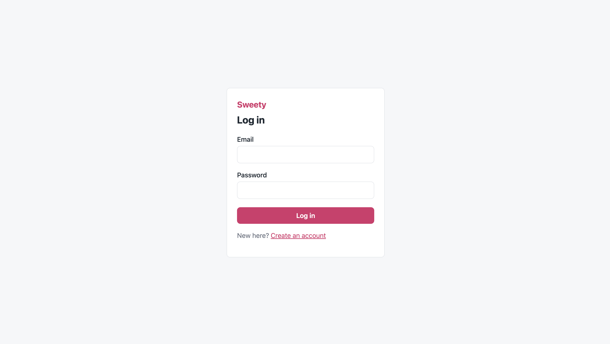
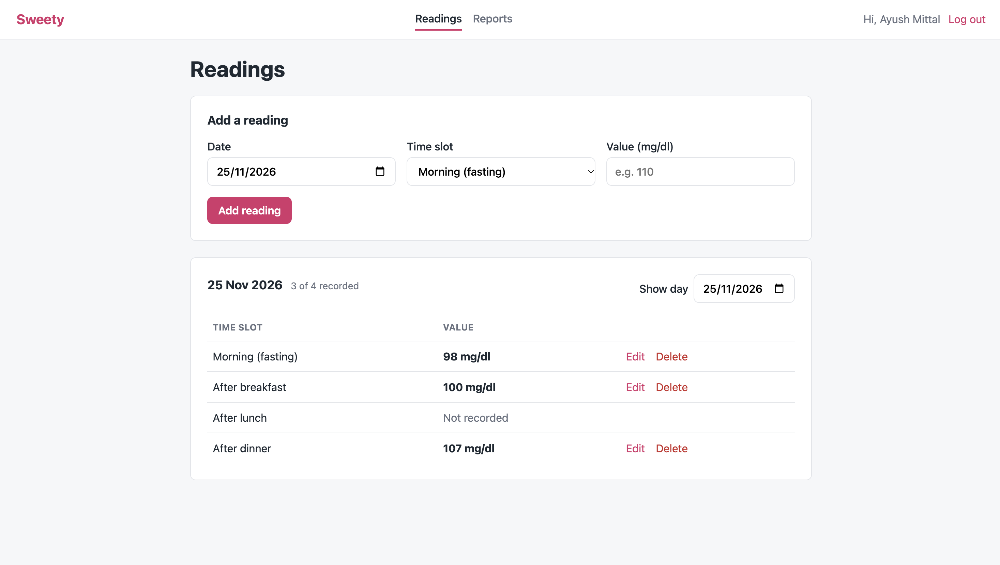
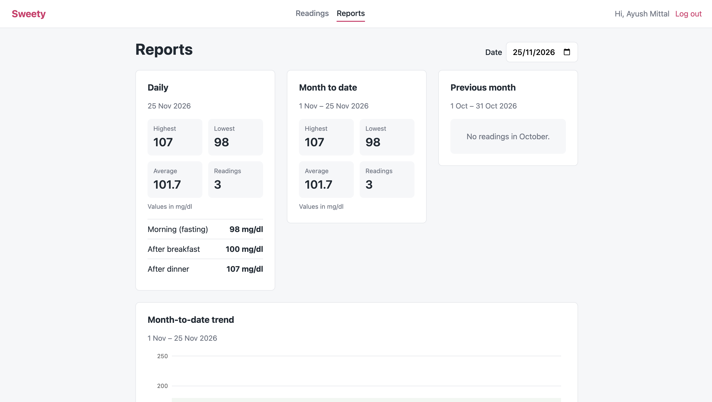
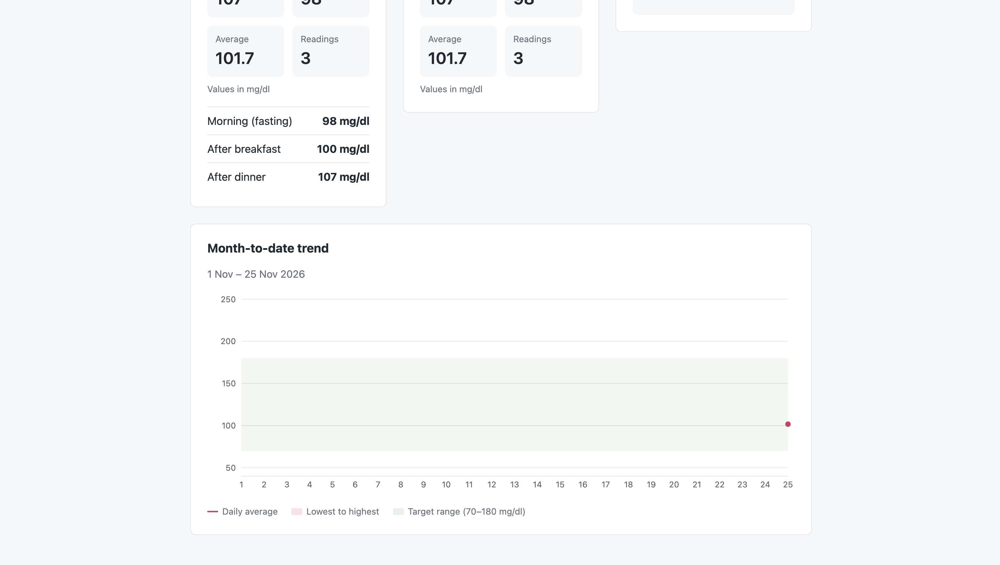

# Sweety

A small blood glucose tracker. A patient can log up to 4 readings a day (one per time slot) and see daily, month-to-date and previous-month reports.

- **Backend:** Node.js, Express 5, PostgreSQL (`pg`, plain SQL), JWT auth, bcrypt
- **Frontend:** React 19, Vite, React Router, plain CSS
- **Tests:** Jest + Supertest against a separate test database

```
sweety/
├── docker-compose.yml     Postgres for local development
├── server/
│   ├── db/schema.sql      tables and constraints
│   ├── scripts/           db setup and seed scripts
│   ├── src/
│   │   ├── routes/        auth, readings, reports
│   │   ├── middleware/    requireAuth
│   │   ├── validation/    reading validation rules
│   │   └── utils/         dates, slots, report date ranges
│   └── tests/
└── client/
    └── src/
        ├── pages/         login, register, readings, reports
        ├── components/    reading form, reading list, report card, layout
        ├── context/       auth state
        └── utils/
```

## Demo

**Screen recording:** [watch on Google Drive](https://drive.google.com/file/d/1qxHs7q1btLReGEX8eadOAI8OulDKa12l/view?usp=sharing)

### Screenshots

| Log in | Readings |
|---|---|
|  |  |

| Reports | Month-to-date chart |
|---|---|
|  |  |

## Getting started

### Prerequisites

- Node.js 20 or newer
- Docker (for Postgres), or a local PostgreSQL 14+ install

### 1. Start the database

```bash
docker compose up -d
```

This starts Postgres on port 5432 and creates two databases: `sweety` for development and `sweety_test` for the test suite.

<details>
<summary>Using a local Postgres instead of Docker</summary>

Create the two databases and update the connection strings in `server/.env` to match your user and password:

```bash
createdb sweety
createdb sweety_test
```

</details>

### 2. Set up and run the server

```bash
cd server
cp .env.example .env      # then set JWT_SECRET to a long random string
npm install
npm run db:setup          # creates the tables
npm run db:seed           # optional: demo user with sample readings
npm run dev               # http://localhost:4000
```

Demo login after seeding: **demo@sweety.app / demo1234**. The seed adds readings from the 1st of last month up to today, so all three reports have data. Running it again resets the demo user.

### 3. Run the client

In a second terminal:

```bash
cd client
npm install
npm run dev               # http://localhost:5173
```

Vite proxies `/api` requests to the server on port 4000, so there is nothing to configure on the client side.

### 4. Run the tests

The database needs to be running (step 1). Tests use `sweety_test` and clear it between tests, so your dev data is never touched.

```bash
cd server
npm test
```

## Environment variables

All of these live in `server/.env` (see `server/.env.example`).

| Variable | Description |
|---|---|
| `PORT` | API port, default `4000` |
| `CLIENT_ORIGIN` | Allowed CORS origin, default `http://localhost:5173` |
| `DATABASE_URL` | Postgres connection string for development |
| `TEST_DATABASE_URL` | Postgres connection string used by `npm test` |
| `JWT_SECRET` | Secret used to sign login tokens. The server refuses to start without it |
| `JWT_EXPIRES_IN` | Token lifetime, default `7d` |

## API

All routes except register and login need an `Authorization: Bearer <token>` header. Errors always come back as `{ "error": "message" }`.

| Method | Route | Description |
|---|---|---|
| POST | `/api/auth/register` | `{ name, email, password }` → `{ token, user }` |
| POST | `/api/auth/login` | `{ email, password }` → `{ token, user }` |
| GET | `/api/auth/me` | Current user (used to restore the session on refresh) |
| GET | `/api/readings?date=&page=&limit=` | Your readings, newest first. All optional: `date` filters to one day, `page` defaults to 1, `limit` defaults to 20 (max 100). Returns `{ readings, pagination: { page, limit, total, totalPages } }` |
| POST | `/api/readings` | `{ date, slot, value }` |
| PUT | `/api/readings/:id` | Replace a reading's date, slot and value |
| DELETE | `/api/readings/:id` | Delete a reading |
| GET | `/api/reports?date=YYYY-MM-DD` | Daily, month-to-date and previous-month stats. Defaults to today. `monthToDate.byDay` has the average, lowest and highest for each day with readings (used by the chart) |

Slots are `morning_fasting`, `after_breakfast`, `after_lunch` and `after_dinner`.

Status codes: `400` for invalid input, `401` when not logged in, `404` for a reading that doesn't exist or belongs to someone else, `409` when a reading conflicts with one that's already saved (same slot, or day already full).

## Notes

### Assumptions

- **"Today" uses the server's timezone.** Dates are stored as plain `DATE` values with no time part. The "date cannot be in the future" rule compares against the server's local date, which can be set with the `TZ` environment variable (for example `TZ=Asia/Kolkata`). The client also blocks future dates using the browser's date, but the server has the final say. With users across timezones, I would store a timezone per user instead.
- **The 4-per-day rule follows from the slot rule.** There are 4 slots and only one reading per slot per day, so a fifth reading can never fit. I still check it explicitly so the user sees "You can add only 4 readings per day." instead of a duplicate-slot message.
- **Values must be whole numbers.** `120.5` is rejected with the same "between 40 and 600" message, since the rule asks for a whole number in that range.
- **"Monthly" means the full calendar month before the selected date's month.** For 15 Oct it's 1–30 Sep, and for any date in January it's December of the previous year.
- **Reports can't be requested for a future date,** for the same reason readings can't be added for one.
- **Averages are rounded by Postgres** (`ROUND(AVG(value)::numeric, 1)`), so 100.66… becomes 100.7.
- **Someone else's reading returns 404, not 403,** so the API doesn't reveal that a reading with that id exists.
- **Editing replaces the whole reading** (PUT, not PATCH). The edit form always sends all three fields, so every field is validated each time.
- **Emails are case-insensitive** (stored in lower case) and passwords need at least 8 characters.

### Design decisions

- **Validation happens in two layers.** The API checks the input first so it can return the exact messages from the spec. The database has a `UNIQUE (user_id, reading_date, slot)` constraint and a `CHECK` on the value range as a safety net. If two identical requests arrive at the same moment and both pass the API check, the unique constraint rejects the second one, and that error is turned into the same friendly message (there is a test for this).
- **Plain SQL with `pg` instead of an ORM.** The app has two tables and a handful of queries, so writing the SQL directly keeps things easy to follow. Every query uses parameters (`$1`, `$2`, …) and filters by the logged-in user's id.
- **Dates stay as `'YYYY-MM-DD'` strings everywhere.** By default `pg` turns `DATE` columns into JavaScript `Date` objects at local midnight, which can move a reading to the previous day depending on the server timezone. I switched that parser off so dates are never shifted.
- **The client shows the API's error messages directly,** so each message is written in one place. The client repeats the simple checks (required, range, future date) only so the user gets instant feedback.

### What I'd improve with more time

- Store the JWT in an httpOnly cookie instead of `localStorage`, so it can't be read by injected scripts, and add refresh tokens.
- Rate limit the login endpoint.
- Use a migration tool (for example `node-pg-migrate`) instead of a single schema file.
- Store a timezone per user (see above).
- Replace `window.confirm` with a proper confirmation dialog, and add toast notifications.
- End-to-end tests with Playwright for the main flows.
- Let users switch between mg/dl and mmol/L.
- Highlight readings outside a target range (for example below 70 or above 180).
